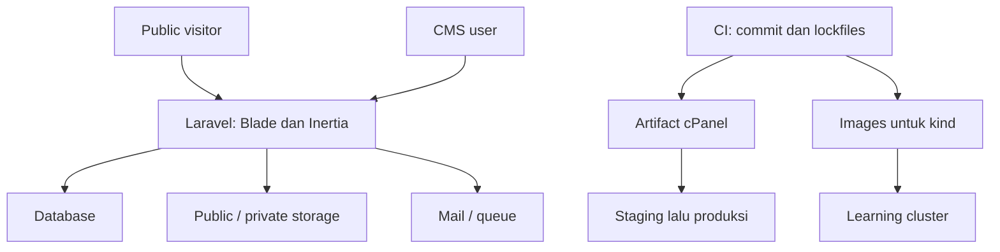

# Software Architecture

**Versi dokumen:** 4.0 · **Diperbarui:** 5 Oktober 2026  
**Status:** spesifikasi implementasi; belum ada bukti aplikasi berjalan dalam paket ini.  
**Kontrak runtime:** Laravel 13.x + PHP **8.3.x**. PHP maksimum cPanel 8.3 dikonfirmasi pengguna; kemampuan hosting lain mengikuti [matriks verifikasi](00-Decisions-and-Hosting-Matrix.md).  
**Kontrak domain:** [Data Model & Business Rules](06-Data-Model-and-Business-Rules.md). **Pengujian:** [Acceptance](08-Acceptance-and-Traceability.md).
## PT Cahya Intan Medika — Company Profile + CMS
### Laravel + Blade + React/Inertia + Docker + CI/CD + Kubernetes Learning

**Architecture Style:** Modular monolith  
**Backend:** Laravel / PHP  
**Public UI:** Blade + Tailwind + lightweight JavaScript/Alpine  
**CMS UI:** React + TypeScript + Inertia.js  
**Database:** MySQL / Eloquent  
**Local Runtime:** Docker Compose  
**Delivery:** GitHub Actions + release artifacts + GHCR  
**Kubernetes:** kind for local learning only  
**Production:** cPanel/shared hosting

---

# 1. Architecture Goals

Architecture must optimize for:

- Simplicity.
- Maintainability.
- Clear domain boundaries.
- Server-side security.
- SEO-friendly public delivery.
- Reproducible local development.
- Automated quality gates.
- Safe production deployment.
- Future portability to VPS/cloud without forcing that complexity today.

The application is intentionally a **modular monolith**, not microservices.

---

# 2. System Context

Public visitor dan CMS user mengakses satu Laravel application. Laravel mengakses database, filesystem dan mail provider melalui adapter; GitHub Actions menghasilkan artifact untuk staging/production serta image untuk kind.



Capability produksi dibuktikan dengan matriks dokumen 00. PHP maksimum yang dikonfirmasi pengguna adalah 8.3.

---

# 3. High-Level Application Architecture

```text
Browser
   │
   ▼
HTTP Router / Laravel Middleware
   │
   ├───────────────────────────────────────────────┐
   │                                               │
   ▼                                               ▼
Public Routes                                  Admin Routes
Blade Controllers                             Auth + Permission Middleware
   │                                               │
   ▼                                               ▼
Blade Views                                  Inertia Controllers
                                                   │
                                                   ▼
                                           React + TypeScript
   │                                               │
   └──────────────────────┬────────────────────────┘
                          ▼
                  Application Services
                          │
             ┌────────────┼─────────────┐
             ▼            ▼             ▼
          Eloquent      Filesystem      Mail/Queue
             │            │             │
             ▼            ▼             ▼
           MySQL       Storage        SMTP/Mailpit
```

---

# 4. Architectural Decision: Modular Monolith

The system remains one deployable Laravel application.

Why:

- Product scope is cohesive.
- One small/medium team can maintain it.
- Shared hosting favors one PHP application.
- Business modules share authentication, media, settings, audit, and database.
- Microservices would add network, deployment, observability, and data-consistency complexity without proportional business benefit.

Module boundaries remain explicit inside the monolith.

---

# 5. Domain Modules

Recommended logical modules:

```text
Identity & Access
├─ Users
├─ Roles
├─ Permissions
└─ Authentication

Catalog
├─ Products
├─ Product Categories
├─ Product Media
├─ Product Specifications
└─ E-Catalog

Content
├─ Activities
├─ Activity Blocks
└─ Media Library

Careers
├─ Vacancies
└─ Applications

Communication
└─ Contact Inquiries

Platform
├─ Site Settings
├─ Audit Log
├─ Storage
└─ SEO
```

These modules may initially share conventional Laravel folders; do not create a heavy module framework merely to look modular.

---

# 6. Layer Responsibilities

## 6.1 Routes

Responsibilities:

- Map URL to controller/action.
- Apply route-level middleware.
- Keep business logic out.

Files:

```text
routes/web.php
routes/admin.php        # optional split loaded by app bootstrap
routes/console.php
```

## 6.2 Controllers

Responsibilities:

- Accept HTTP request.
- Trigger authorization.
- Delegate validation to Form Request.
- Call application/service/action layer when logic is non-trivial.
- Return Blade/Inertia/redirect/download response.

Controllers should remain thin.

## 6.3 Form Requests

Responsibilities:

- Input normalization where appropriate.
- Validation rules.
- Request-level authorization where it improves clarity.

Do not put large business workflows in validation classes.

## 6.4 Policies / Gates

Responsibilities:

- Authoritative server-side authorization.
- Entity-specific access rules.
- Permission mapping.

## 6.5 Services / Actions

Use when an operation involves meaningful workflow, multiple models, storage, audit, or side effects.

Example:

```text
PublishProduct
CreateCareerApplication
StorePrivateCv
UpdateUserRoles
DeleteMediaSafely
```

Simple single-model CRUD does not need ceremonial service classes.

## 6.6 Models

Responsibilities:

- Relationships.
- Casts.
- scopes.
- small entity-related behavior.

Avoid giant models containing all orchestration logic.

## 6.7 Resources / Data Transfer

For Inertia props or API-like structured responses, use Resource/DTO patterns where they materially improve stable data contracts.

Do not serialize entire Eloquent models blindly to the frontend.

---

# 7. Public Rendering Architecture

Public routes use Blade/server-side rendering.

```text
GET /products/{slug}
        │
        ▼
ProductController
        │
        ├─ query published Product
        ├─ load required relations
        ├─ prepare SEO data
        │
        ▼
Blade View
        │
        ▼
Complete HTML Response
```

Benefits:

- Good SEO baseline.
- No Node server required in production.
- Lower JavaScript dependency.
- Natural cPanel/PHP deployment.

Client JavaScript is progressive enhancement.

---

# 8. CMS Rendering Architecture

CMS uses Inertia + React.

```text
GET /admin/products
        │
        ▼
Auth Middleware
        │
        ▼
Permission Middleware / Policy
        │
        ▼
Admin Product Controller
        │
        ▼
Inertia::render(...)
        │
        ▼
React Page Component
```

Mutation example:

```text
React Form
   │ POST/PATCH
   ▼
Laravel Route
   ▼
Form Request
   ▼
Policy/Gate
   ▼
Action/Service
   ├─ DB transaction
   ├─ storage if needed
   └─ audit
   ▼
Redirect / Inertia response
```

---

# 9. Authentication Architecture

Authentication is session-based.

```text
Browser
   │ login
   ▼
Laravel Auth
   │
   ▼
Database-backed Session
   │
   ▼
Authenticated Requests
```

Requirements:

- Secure session cookie.
- CSRF protection.
- Login rate limiting.
- Public registration disabled.
- Inactive users blocked pada setiap request; deaktivasi mencabut session/remember token.
- Permission changes berlaku pada request berikutnya; reset tidak membocorkan keberadaan akun.
- Password reset through mail.

Database-backed sessions are chosen initially because they are compatible with shared hosting and avoid mandatory Redis.

---

# 10. RBAC Architecture

User ↔ Role ↔ Permission menggunakan relational pivots. Laravel middleware, Policies dan Gates adalah server authority untuk read/list/mutation/download/export; Inertia props hanya menyajikan capability yang aman.

Matriks lengkap dan permission names: dokumen 06 bagian 3. Super Admin aktif terakhir dilindungi transaksi dengan guard lock. Assignment berprivilege tinggi tidak dapat dilakukan hanya dengan memodifikasi body request. Dashboard queries dibatasi domain read permission. Private CV memerlukan application.read + application.download; ekspor memerlukan read + export.

Business action tidak menerima actor/role/permission dari input yang tidak dipercaya. Actor berasal dari session authenticated. Service yang dipanggil oleh command/job memiliki konteks sistem dan scope eksplisit serta audit.

---

# 11. Database and Publication Architecture

Kontrak schema/ERD ada pada [dokumen 06](06-Data-Model-and-Business-Rules.md). Target awal lokal MySQL 8.4 LTS; actual hosting DB diverifikasi sebelum Phase 2 dan diuji pada CI. Schema migration-driven dengan FK, unique constraints, index berdasarkan query, eager loading, transaction dan optimistic lock_version.

Product/Activity memiliki entity identity/status dan dua slot revision: WORKING/PUBLISHED. Relasi gallery/spec/block/related terikat revision. Save draft hanya menyentuh WORKING; publish memvalidasi dan menyalin data/relasi ke PUBLISHED dalam transaksi. Public reads selalu menggabungkan entity visible dengan PUBLISHED revision; jangan mengambil relation WORKING secara tidak sengaja.

Slug publik hanya berubah pada publish transaction dan menyimpan redirect lama. Cache/sitemap/schema mengikuti published revision. Tidak ada full revision history pada baseline. Draft media tetap dihitung sebagai reference yang melindungi file dari deletion.

Career/E-Catalog yang sedang live tidak memakai mekanisme dua-slot: editing data publik memerlukan update + publish. UI memberi tahu bahwa save tersebut mengubah publik.

---

# 12. Storage Architecture

Use Laravel Filesystem abstraction.

Logical disks:

```text
public
private
```

Public examples:

```text
products/
activities/
company/
brochures/
```

Private examples:

```text
career/
```

Private download sequence:

```text
Admin Request
   ↓
Authentication
   ↓
Permission: application.download
   ↓
Locate private file
   ↓
Stream/download response
```

Never expose a direct public URL for private CVs.

---

# 13. Upload and Content Security Architecture

Urutan upload: request size limit → extension/MIME/signature validation → ukuran/dimensi/parser → randomized filename → approved disk → DB metadata/reference → cleanup on failure. Batas pasti ada pada dokumen 06. Signature check tidak sendirian menjamin keamanan file.

Public Media Library hanya menyajikan disk public. CV tersimpan di private/career, tidak punya direct public URL, tidak menjadi shared Inertia props. Download lewat authorized controller dengan attachment disposition. SVG disabled; AVIF menunggu verifikasi driver; Activity video memakai HTTPS embed allowlist.

Activity structured blocks divalidasi per type. HTML terbatas disanitasi di server; URL protocol/iframe/script bebas ditolak. Media deletion memeriksa FK dan usage registry dalam transaksi/race-safe locking. Replace mengubah reference terpilih ke file baru, tidak menimpa file global.

---

# 14. Email Architecture

Local:

```text
Laravel Mail
    ↓ SMTP
Mailpit
```

Production:

```text
Laravel Mail
    ↓ SMTP
Production Mail Provider / cPanel SMTP
```

Mail examples:

- Password reset.
- Future internal notification.

Email sending should not make critical DB state inconsistent.

If queueing is used, failure behavior must be logged and retryable.

---

# 15. Queue Architecture

Driver awal database, tanpa mandatory Redis. Local worker/scheduler service ditambahkan ketika jobs diperlukan. Dispatch notification setelah DB commit, dengan job idempotent, timeout/retry/backoff/failed-job visibility.

cPanel executor bergantung capability yang diverifikasi: managed worker bila tersedia, otherwise cron menjalankan bounded worker dengan overlap lock. Bila tidak ada executor, synchronous mail dengan failure recording/manual retry adalah fallback yang harus diuji dan tercatat. Persistence application/inquiry tidak dibatalkan karena SMTP gagal.

Jangan menyebut QUEUE_CONNECTION=database sebagai bukti jobs diproses. Prosedur lengkap dan keterbatasan di dokumen 09 bagian 8.

---

# 16. Scheduler Architecture

Use Laravel Scheduler for jobs such as:

- cleanup temporary files.
- future content maintenance.
- scheduled operational tasks.

Production requirement:

- cPanel cron must be verified, termasuk interval/CLI PHP dan overlap handling.
- Deadline publik dicek saat query/submit; tidak bergantung scheduler berhasil.
- Retention/backup memerlukan executor atau jadwal manual dengan owner yang jelas.

Local scheduler can run via Docker command/service when needed.

---

# 17. Audit Architecture

Audit event schema captures:

- actor.
- action.
- entity type.
- entity ID.
- changed fields where useful.
- result.
- timestamp.
- request metadata where reasonable.

Typical sequence:

```text
Authorized Mutation
       ↓
DB Operation
       ↓
Audit Event
       ↓
Commit transaction / controlled side effect
```

Do not log secrets/password contents.

---

# 18. SEO Architecture

SEO data derives from:

- entity content.
- site settings.
- page type defaults.

Public response may include:

- title.
- description.
- canonical.
- Open Graph.
- JSON-LD.

Structured data types:

```text
Organization
Product
Article
JobPosting
BreadcrumbList
```

Only published/indexable content enters sitemap and public structured data.

---

# 19. Cache Architecture

Start conservative.

Initial cache store may be database/file depending final hosting capability and workload.

Rules:

- Do not introduce Redis as mandatory infrastructure initially.
- Cache only when a measured or obvious benefit exists.
- Define invalidation strategy before caching mutable CMS content.
- Public content cache must invalidate on publish/update/archive.

---

# 20. Error Handling

Production behavior:

- User receives safe message.
- Internal details go to logs.
- No stack trace shown publicly.
- Validation errors remain field-specific.
- Authorization returns appropriate 403/redirect behavior.
- Missing public content returns 404.

---

# 21. Local Docker Architecture

```text
┌───────────────────────────────────────────────────────┐
│                    Docker Network                     │
│                                                       │
│  Browser                                              │
│     │                                                 │
│     ▼                                                 │
│  ┌───────┐      FastCGI      ┌──────────────────┐    │
│  │ Nginx │ ────────────────► │ App / PHP-FPM    │    │
│  └───────┘                   │ Laravel          │    │
│                              └───────┬──────────┘    │
│                                      │               │
│                ┌─────────────────────┼───────────┐   │
│                ▼                     ▼           ▼   │
│             ┌───────┐           ┌────────┐   ┌─────┐│
│             │ MySQL │           │Mailpit │   │Node ││
│             └───┬───┘           └────────┘   │Vite ││
│                 │                            └─────┘│
│                 ▼                                   │
│            Named Volume                             │
└───────────────────────────────────────────────────────┘
```

Node/Vite is a development/build concern, not a required production application server.

---

# 22. Docker Service Responsibilities

## nginx

- HTTP entrypoint locally.
- Serve public/static assets.
- Forward PHP requests to app/PHP-FPM.

## app

- PHP runtime.
- Laravel.
- Composer dependencies.
- artisan commands.

## node

- npm dependency management.
- Vite dev server/build.
- TypeScript/ESLint/frontend tests.

## mysql

- Application database.
- Named persistent volume.
- Healthcheck.

## mailpit

- Local SMTP capture.
- Development email inspection UI.

## adminer optional

- Local DB inspection only.
- Not a production dependency.

---

# 23. Production-Oriented Container Images

cPanel menerima archive artifact; container images dipakai untuk CI validation, kind learning dan portabilitas.

Logical build: Composer production dependencies di PHP 8.3 + Node 24 Vite build → PHP-FPM runtime image; static assets/Nginx config dari release yang sama → web-server image. Pin tag/digest yang diuji dan catat commit identik. Jangan mengirim dev tools/secrets/user uploads pada runtime image.

kind Web Pod menjalankan **dua container Nginx + PHP-FPM**; Nginx melayani HTTP port 80 dan meneruskan PHP ke FPM dalam Pod. Source/public/build yang dibutuhkan Nginx/FPM harus berasal dari release yang sama dan dipetakan eksplisit; jangan mengandalkan source bind mount host. Service port 80 mengarah ke Nginx, bukan langsung ke port FastCGI.

Build artifact cPanel menggunakan output dependency/assets yang sama secara logis dari commit/lockfile yang sama; byte image dan archive tentu berbeda. Staging dan produksi cPanel mempromosikan archive checksum yang persis sama.

---

# 24. CI Architecture

```text
Pull Request / Push
        │
        ▼
GitHub Actions
        │
        ├─ PHP Quality
        ├─ JS Quality
        ├─ Backend Tests
        ├─ Frontend Tests
        ├─ Vite Build
        ├─ Security Audit
        └─ Docker Build
                │
                ▼
          Required Checks
                │
        ┌───────┴────────┐
        │                │
      Fail             Pass
        │                │
  Merge blocked       Merge allowed
```

CI environments use test-only secrets and isolated MySQL.

---

# 25. Release Architecture

Exact commit yang lolos required checks → version tag → build cPanel artifact (vendor produksi + assets) dan container images → manifest/checksum/digest → staging acceptance → approval → produksi dengan **artifact yang sama**.

Tidak rebuild vendor/assets setelah staging. No production secrets in CI untrusted PR. Konfigurasi runtime cache dibuat di environment tujuan; production APP_KEY stabil. Periksa kemampuan GitHub untuk enforcement branch/tag/environment sebelum mengklaim gate otomatis tersedia.

---

# 26. Staging Architecture

```text
GitHub Actions
      │
      ▼
Staging Release
      │
      ▼
staging.<domain>
      │
  ┌───┼─────────┐
  ▼   ▼         ▼
 PHP MySQL   Storage/SMTP
```

Staging data/secrets are isolated from production.

CMS displays `STAGING` badge.

---

# 27. Production Architecture

Target topology:

```text
Internet
   │ HTTPS
   ▼
cPanel / Apache or provider web server
   │
   ▼
Laravel PHP Application
   │
   ├────────► MySQL
   ├────────► cPanel Filesystem
   └────────► SMTP
```

No persistent Node server is required.

No Kubernetes control plane is assumed.

---

# 28. Production Deployment Architecture

Preferred: releases/<release-id>, shared/.env, shared/storage, current symlink → release aktif, webroot current/public. Semua path harus disesuaikan dengan provider, bukan mengasumsikan akses root server.

Fallback tanpa symlink memakai maintenance window dan update direktori aplikasi/public yang terkontrol, preserve .env/storage dan backup aplikasi sebelumnya. Root project tidak boleh dihidangkan ke internet. Tanpa storage symlink, controlled public media route boleh dipakai; private CV tetap terpisah.

Dokumen 09 adalah runbook authoritative, termasuk gate ketika hanya SFTP tersedia tanpa cara aman menjalankan migration.

---

# 29. Deployment Sequence

Approved release → backup → upload/verify artifact → bind environment/storage → PHP 8.3 platform check → migration terkontrol → runtime cache/preflight → **activate** → **post-activation smoke** → monitor atau rollback.

Preflight sebelum aktivasi tidak menggantikan smoke URL aktif. Staging menjalankan urutan yang sama dengan secret/data sendiri. Perintah, maintenance fallback dan metode release lock harus sudah diuji; detail pada dokumen 09 bagian 3–7.

---

# 30. Rollback Architecture

Rollback aplikasi mengaktifkan artifact sebelumnya dan mengikat persistent environment/storage yang sama, lalu restart worker/opcode cache sesuai provider dan smoke test. APP_KEY tidak dibuat ulang.

Migration harus compatible melalui expand/backfill/contract. Jika DB tidak compatible, tentukan forward fix atau recovery snapshot yang konsisten; jangan otomatis migrate:rollback atau memulihkan DB lama tanpa menilai kehilangan data baru. Reapply deletion ledger untuk data pribadi. Lihat dokumen 09 bagian 6 dan 9.

---

# 31. Kubernetes Local Architecture

kind namespace cim-local: ConfigMap; non-production Secret; Deployment cim-web (Nginx + PHP-FPM); Service HTTP cim-web; MySQL StatefulSet/Service/PVC; versioned migration Job. Mulai satu web replica. Media PVC dipakai untuk menguji persistence pada satu replica; jangan menganggap volume ini aman untuk arbitrary multi-replica.

Gunakan image PHP 8.3 dan web assets dari commit release yang sama. Stable APP_KEY dibagikan kepada semua web replicas dalam environment yang sama. Registry pull atau kind load menggunakan image tag/digest eksplisit.

Kubernetes phase memiliki learning acceptance sendiri dan tidak memblokir staging/production cPanel.

---

# 32. Kubernetes Request Flow

```text
Browser
   │ port-forward / ingress
   ▼
Service cim-web
   │
   ▼
Web Pod
   │
   ├─► Service mysql ─► MySQL StatefulSet/PVC
   │
   └─► ConfigMap/Secret env
```

---

# 33. Kubernetes Migration and Probe Flow

Config/DB ready → migration Job untuk release tertentu → Job succeeded → web rollout → readiness menerima trafik. Job gagal menghentikan rollout, tidak menjalankan migration pada setiap startup replica.

- Liveness: proses/boot dasar hidup; hindari menjadikan outage database sebagai penyebab restart loop seluruh app.
- Readiness: instance siap menerima request, dependency/schema yang diperlukan tersedia; failure mengeluarkan Pod dari trafik.
- Startup probe bila boot membutuhkan waktu; parameter dibuktikan lewat latihan failure.
- Rollout/rollback menggunakan image versioned, dan mempertimbangkan kompatibilitas migration sama seperti rilis aplikasi.

Simulasikan salah password DB/readiness endpoint dan catat logs/describe/events. Tidak menggunakan production secrets/data.

---

# 34. Scaling Constraints

Web layer can conceptually scale horizontally only if state is externalized consistently.

Considerations:

- Database-backed sessions support multi-instance better than local file sessions.
- Writable local media storage becomes problematic across replicas.
- Shared/object storage is preferred for larger multi-replica production architectures.

Current project production on cPanel does not target multi-replica Kubernetes.

---

# 35. Security Boundaries

Trust boundaries:

```text
Public Internet
      ↓
HTTP Validation + CSRF/Auth
      ↓
Authorization
      ↓
Application Logic
      ↓
Database / Storage / Mail
```

Critical rules:

- Never trust client-provided permission state.
- Validate uploaded files.
- Escape/sanitize user-generated HTML according to content model.
- Keep secrets server-side.
- Avoid mass assignment mistakes.
- Protect private file paths.
- Rate limit sensitive public forms/auth.

---

# 36. Transaction Boundaries

Use DB transactions when an operation must commit atomically.

Example Product publish:

```text
Validate
  ↓
Authorize
  ↓
Begin Transaction
  ↓
Update Product
  ↓
Update relations
  ↓
Write audit data
  ↓
Commit
```

Filesystem side effects require care because filesystem and DB do not share one atomic transaction. Design compensation/cleanup when necessary.

---

# 37. Performance Architecture

Start with correctness, then optimize measured hot paths.

Primary practices:

- Eager load intentional relations.
- Pagination.
- indexes.
- limit selected data.
- server-render public content.
- minimize public JS.
- image optimization.
- cache with explicit invalidation.

Avoid premature Redis/search infrastructure.

---

# 38. Observability Architecture

Layers:

```text
Application → Laravel logs
Container   → docker compose logs
CI          → GitHub Actions logs
Kubernetes  → kubectl logs/describe/events
Hosting     → cPanel/server logs
```

Logs must not contain passwords, auth secrets, CV contents, or unnecessary personal data. Tambahkan monitoring pending/failed jobs, scheduler last-run, free storage, backup last-success dan release identifier. Retensi logs/audit/backup mengikuti dokumen 09.

---

# 39. Environment Configuration

Environment variables configure infrastructure, not business data that belongs in DB settings.

Examples:

```text
APP_ENV
APP_KEY
APP_URL
DB_*
MAIL_*
FILESYSTEM_DISK
SESSION_DRIVER
QUEUE_CONNECTION
```

Business-editable settings belong in Site Settings database records.

---

# 40. Dependency Rules

Prefer:

- Laravel built-ins first.
- Mature packages when they remove substantial risk/complexity.
- Minimal frontend dependencies.

Before adding package:

1. What problem does it solve?
2. Can project/framework already solve it clearly?
3. Is it maintained?
4. What is its security/upgrade cost?
5. Does it affect shared-hosting compatibility?

---

# 41. Architectural Anti-Patterns to Avoid

Do not:

- Split Laravel backend and separate Next.js frontend without a real product need.
- Create microservices for simple CRUD domains.
- Put business logic in Blade/React components.
- Trust frontend authorization.
- Store private CVs in public web directories.
- Make Redis mandatory before hosting capability is confirmed.
- Run migrations blindly in every app startup.
- Couple business rules to Docker/Kubernetes.
- Add repository/service abstractions around Eloquent purely for ceremony.
- Use global helper state for complex domain logic when explicit services/actions are clearer.

---

# 42. Architecture Decision Records Recommended

For material future changes, add lightweight ADRs under:

```text
docs/adr/
```

Suggested ADR topics:

```text
0001-modular-monolith.md
0002-public-blade-cms-inertia.md
0003-database-session.md
0004-public-private-storage.md
0005-docker-local-source-of-truth.md
0006-cpanel-production-target.md
```

Each ADR should capture:

- Context.
- Decision.
- Alternatives.
- Consequences.

---

# 43. Architecture Acceptance Criteria

- [ ] One Laravel modular monolith remains the deployable application.
- [ ] Public routes render server-side HTML.
- [ ] CMS uses React/Inertia without separate REST API requirement.
- [ ] Server-side authorization protects all sensitive mutations.
- [ ] MySQL schema is migration-driven.
- [ ] Public/private storage boundaries exist.
- [ ] Docker Compose reproduces local runtime.
- [ ] Production Docker image builds.
- [ ] CI validates code/tests/build.
- [ ] Releases are traceable to Git commits.
- [ ] kind runs the same application architecture for learning.
- [ ] cPanel production does not depend on Docker/Kubernetes/Node server.
- [ ] Deployment and rollback paths are documented.
