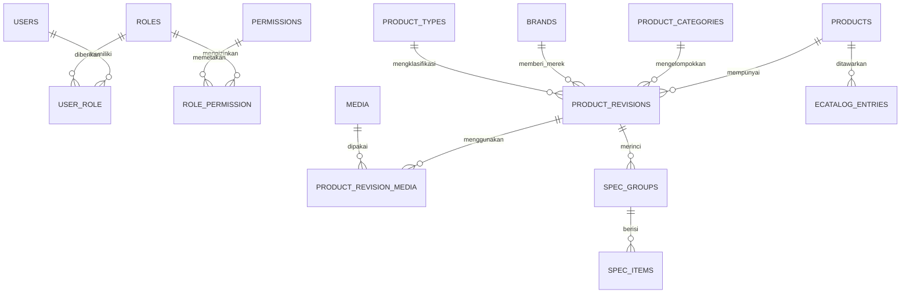
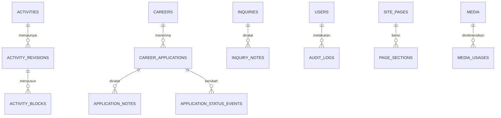

# Data Model & Business Rules

**Versi:** 4.0 · **Tanggal:** 5 Oktober 2026  
**Status:** kontrak implementasi yang disetujui; belum berupa migration/kode berjalan.  
**Terkait:** [PRD](01-PRD.md), [Keputusan](00-Decisions-and-Hosting-Matrix.md), [Acceptance](08-Acceptance-and-Traceability.md).

## 1. Konvensi data

- Target awal MySQL 8.4 LTS. Engine/versi hosting harus diverifikasi sebelum schema Phase 2; gunakan engine tujuan yang sama dalam pengujian integrasi.
- Default PK `id BIGINT UNSIGNED`; semua FK ke PK tersebut memakai tipe yang sama. Tabel relasi boleh menggunakan composite PK yang ditentukan di bawah.
- Timestamp disimpan UTC menggunakan `DATETIME(6)`; UI memakai zona bisnis `Asia/Makassar`. Tanggal kalender tanpa waktu menggunakan `DATE`.
- Charset `utf8mb4`; collation ditetapkan setelah engine target dikonfirmasi, konsisten pada seluruh kolom FK/unique yang terkait. Jangan hard-code collation khusus satu engine sebelum pemeriksaan.
- `created_at`, `updated_at` non-null pada entity/record mutable kecuali dinyatakan lain. Tabel append-only memiliki `created_at` saja.
- Notasi `?` berarti nullable. Kolom lain wajib diisi; setiap default ditulis eksplisit. Panjang maksimum juga divalidasi oleh Form Request.
- Status disimpan `VARCHAR(32)` dan dicast PHP backed enum. Allowed values diuji di server; DB CHECK hanya ditambahkan bila engine tujuan benar-benar menegakkannya.
- Foreign key default `RESTRICT`; tidak menghapus lamaran, referensi media, atau audit dengan cascade dari user/konten. Pivot murni boleh `CASCADE` saat owner benar-benar dihapus dengan action yang sah.
- Business transaction dan filesystem tidak atomik bersama: upload menggunakan staging path privat/temporary, commit metadata, lalu cleanup/compensation pada kegagalan. Uji tidak meninggalkan file yatim setelah transaksi gagal.
- Semua form edit entity menyediakan `lock_version INT UNSIGNED DEFAULT 1`. Update mencocokkan versi lama, menambah versi, dan menolak stale edit dengan pesan konflik tanpa menimpa data terbaru.

## 2. ERD inti

Diagram hanya menunjukkan hubungan utama; tabel operasional ada pada kamus data.

## 3. Identity, role, dan permission

| Tabel | Kolom domain | Constraint / index |
|---|---|---|
| `users` | `name VARCHAR(150)`, `email VARCHAR(254)`, `password VARCHAR(255)` hash, `is_active BOOLEAN DEFAULT true`, `email_verified_at DATETIME(6)?`, `remember_token VARCHAR(100)?`, `lock_version` | UNIQUE email; normalisasi email sebelum simpan; akun dinonaktifkan alih-alih dihapus |
| `roles` | `name VARCHAR(80)`, `description VARCHAR(255)?`, `is_system BOOLEAN DEFAULT false`, `lock_version` | UNIQUE name; role Super Admin sistem tidak dapat dihapus/diubah semantik |
| `permissions` | `name VARCHAR(100)`, `description VARCHAR(255)?` | UNIQUE name; didefinisikan kode/seed, bukan string bebas dari browser |
| `user_role` | `user_id`, `role_id` | PK(user_id,role_id); FK masing-masing |
| `role_permission` | `role_id`, `permission_id` | PK(role_id,permission_id); FK masing-masing |

Gunakan sessions/password_reset_tokens/jobs/failed_jobs/job_batches/cache/cache_locks sesuai schema framework yang benar-benar dipilih, tanpa mengarang bentuk tabel Laravel. Seed hanya core permission, template role, dan konten sintetis untuk local/test. Akun produksi dibuat melalui prosedur bootstrap privat yang terdokumentasi; tidak ada password default publik.

### 3.1 Daftar permission final

| Domain | Tindakan |
|---|---|
| `product`, `ecatalog`, `activity` | `read`, `create`, `update`, `delete`, `publish`, `archive` |
| `career` | `read`, `create`, `update`, `delete`, `publish`, `close`, `archive` |
| `taxonomy` | `read`, `manage` |
| `application` | `read`, `update`, `delete`, `download`, `export` |
| `inquiry` | `read`, `update`, `delete`, `export` |
| `media` | `read`, `upload`, `update`, `delete` |
| `page` | `read`, `update` |
| `settings` | `read`, `update` |
| `user` | `read`, `create`, `update`, `disable`, `assign_roles` |
| `role` | `read`, `manage` |
| `audit` | `read` |

Nama final adalah `<domain>.<action>`. Account sendiri menggunakan policy kepemilikan; tidak membutuhkan `user.update` untuk mengganti password sendiri. Dashboard hanya mengagregasi domain yang boleh dibaca. Tidak membocorkan jumlah pelamar/inquiry kepada pengguna tanpa izin.

### 3.2 Template role awal

| Role | Izin awal | Batas |
|---|---|---|
| Super Admin | Semua permission | Bukan bypass is_active; semua operasi sensitif tetap diaudit |
| Admin | read/create/update/publish/archive Product, E-Catalog, Activity; taxonomy.read/manage; media.read/upload/update; page.read/update; settings.read/update; inquiry.read/update | Tidak otomatis application, account/role management, hard-delete, export atau audit global |
| Editor | product.read/create/update; ecatalog.read/create/update; activity.read/create/update; taxonomy.read; media.read/upload/update; page.read | Tidak publish/archive/delete, tidak mengubah page live |
| Product | product.read/create/update; ecatalog.read/create/update; taxonomy.read/manage; media.read/upload/update | Publish diberikan eksplisit oleh Super Admin; default tidak publish |
| HR | career.read/create/update/publish/close/archive; application.read/update/download | Export/delete diberikan eksplisit; tidak settings, role atau konten lain |
| Read Only | product.read; ecatalog.read; activity.read; career.read; taxonomy.read; page.read | Tanpa data pelamar/inquiry, CV, export atau media privat |

Role dinamis boleh dibuat. Hak pengelolaan identitas (`user.*`, `role.manage`) dan destructive purge diberikan hanya kepada Super Admin pada baseline; jangan memberikan hak itu otomatis melalui role bernama Admin. Penambahan hak di masa depan membutuhkan perubahan matriks dan test.

### 3.3 Batas otorisasi

- Deny by default; setiap list/detail/mutation/download/export memeriksa policy. UI menyembunyikan aksi yang tidak diizinkan.
- Update tidak boleh menyisipkan status publish. Publish/close/archive adalah tindakan tersendiri yang memeriksa izin, termasuk untuk request langsung.
- `role.manage` saja tidak memberi hak menaikkan diri. Assignment dan permission grant memeriksa allowlist hak yang dapat didelegasikan; Super Admin role hanya dapat diberikan/dicabut oleh Super Admin aktif.
- Setiap perubahan yang menghapus/menonaktifkan Super Admin aktif terakhir ditolak dalam transaksi berserial pada baris guard (misalnya singleton `access_guards`, id=1 dikunci `FOR UPDATE`), agar dua request bersamaan tidak melewati hitungan terakhir.
- Middleware mengecek is_active pada setiap authenticated request; deaktivasi mencabut sesi dan remember tokens. Perubahan permission berlaku pada request berikutnya (invalidate cache jika digunakan).
- CV download memerlukan `application.read` DAN `application.download`. Export memerlukan read DAN export domain. Tidak menerima private path dari browser.

## 4. Catalog & revisi terbit

| Tabel | Kolom domain | Constraint / index |
|---|---|---|
| `product_categories` | `name VARCHAR(120)`, `slug VARCHAR(160)`, `description TEXT?`, `sort_order INT DEFAULT 0`, `is_active BOOLEAN DEFAULT true`, `lock_version` | UNIQUE slug; taksonomi satu tingkat pada release awal |
| `brands` | `name VARCHAR(120)`, `slug VARCHAR(160)`, `is_active BOOLEAN DEFAULT true`, `lock_version` | UNIQUE slug |
| `product_types` | `name VARCHAR(120)`, `slug VARCHAR(160)`, `is_active BOOLEAN DEFAULT true`, `lock_version` | UNIQUE slug |
| `products` | `public_slug VARCHAR(180)?`, `status VARCHAR(32) DEFAULT 'DRAFT'`, `published_at DATETIME(6)?`, `archived_at DATETIME(6)?`, `created_by`, `updated_by`, `lock_version` | UNIQUE public_slug; INDEX(status,published_at,id); user FK RESTRICT |
| `product_revisions` | `product_id`, `kind VARCHAR(16)` WORKING/PUBLISHED, `requested_slug VARCHAR(180)`, `name VARCHAR(200)`, `summary VARCHAR(500)?`, `description TEXT?`, `category_id?`, `brand_id?`, `type_id?`, `is_featured BOOLEAN DEFAULT false`, `seo_title VARCHAR(200)?`, `seo_description VARCHAR(500)?`, `og_media_id?`, `updated_by` | UNIQUE(product_id,kind); category/brand/type FK; nullable category hanya saat draft; INDEX(kind,category_id,brand_id,type_id) |
| `product_revision_media` | `revision_id`, `media_id`, `role VARCHAR(16)` FEATURED/GALLERY/BROCHURE, `sort_order INT DEFAULT 0`, `alt_text VARCHAR(500)?`, `caption VARCHAR(1000)?` | UNIQUE(revision_id,media_id,role); satu FEATURED dan satu BROCHURE per revision dijaga action; IMAGE untuk featured/gallery, PDF untuk brochure |
| `product_highlights` | `revision_id`, `text VARCHAR(500)`, `sort_order INT DEFAULT 0` | FK revision; INDEX(revision_id,sort_order,id) |
| `spec_groups` | `revision_id`, `name VARCHAR(150)`, `sort_order INT DEFAULT 0` | FK revision; INDEX(revision_id,sort_order,id) |
| `spec_items` | `group_id`, `label VARCHAR(150)`, `value TEXT`, `unit VARCHAR(50)?`, `sort_order INT DEFAULT 0` | FK group; INDEX(group_id,sort_order,id) |
| `product_revision_related` | `revision_id`, `related_product_id`, `sort_order INT DEFAULT 0` | PK(revision_id,related_product_id); self relation ditolak |
| `ecatalog_entries` | `product_id`, `catalog_code VARCHAR(120)`, `procurement_title VARCHAR(200)`, `procurement_category VARCHAR(150)?`, `notes TEXT?`, `unit_package VARCHAR(150)?`, `availability VARCHAR(32) DEFAULT 'CONTACT_US'`, `reference_url VARCHAR(2048)?`, `effective_at DATETIME(6)?`, `expires_at DATETIME(6)?`, `status VARCHAR(32) DEFAULT 'DRAFT'`, `sort_order INT DEFAULT 0`, `seo_title VARCHAR(200)?`, `seo_description VARCHAR(500)?`, `published_at DATETIME(6)?`, `lock_version` | UNIQUE catalog_code setelah trim/normalisasi kode; FK product RESTRICT; INDEX(status,product_id); INDEX(expires_at) |

Availability: AVAILABLE / UNAVAILABLE / CONTACT_US; tidak mengklaim stok realtime. Katalog eksternal ditampilkan sebagai link HTTPS tervalidasi, bukan data otomatis hasil crawling/API. SEO record E-Catalog disimpan untuk penggunaan terstruktur; release awal hanya mempunyai halaman `/e-catalog`, tidak membuat route detail baru secara implisit. Metadata listing berasal dari Site Page.

### 4.1 Mekanisme revisi

1. Create membuat entity DRAFT dan WORKING revision. Public tidak membacanya.
2. Save draft hanya mengubah WORKING revision beserta relasinya, dengan pemeriksaan lock_version.
3. Publish memeriksa izin, versi, field wajib, kategori aktif, validitas media, slug unik, dan relation integrity; transaksi mengunci entity.
4. Publish menyalin WORKING ke PUBLISHED secara atomik beserta gallery/spec/highlight/related. PUBLISHED lama diganti; versi history lengkap belum disediakan. Audit mencatat field berubah tanpa konten sensitif.
5. `public_slug` di entity diubah hanya dalam publish transaction. Desired slug di WORKING tidak mengubah URL live. Konflik slug ditolak tanpa perubahan parsial.
6. WORKING tetap tersedia dan menjadi dasar revisi berikutnya. Indikator unpublished changes ditentukan dari perbandingan content hash yang dihitung canonical di server atau perbandingan data setara; bukan dari flag kiriman browser.
7. Public list/search/filter/detail membaca PUBLISHED revision saja, dengan entity status PUBLISHED. Draft gallery/specs tidak boleh masuk response, cache, sitemap atau schema.
8. Archive menyembunyikan entity dari publik; unpublish kembali ke DRAFT memerlukan publish permission. Re-publish dari ARCHIVED juga memerlukan publish permission dan validasi lengkap.

Perubahan label taxonomy dapat memengaruhi banyak item publik. `taxonomy.manage` memberi kewenangan tersebut, dengan confirmation jumlah dampak dan audit. Role ini tidak boleh dipakai mengubah status/slug/entity produk. Taxonomy yang dipakai tidak boleh dihapus; penonaktifan mencegah pemilihan baru, tidak menghilangkan relasi pada produk terbit yang ada.

### 4.2 Visibilitas E-Catalog

Visible jika status PUBLISHED, produk terkait PUBLISHED, `effective_at IS NULL OR effective_at <= now`, dan `expires_at IS NULL OR now < expires_at`.

- `expires_at > effective_at` jika keduanya diisi.
- Tanggal akhir tanpa jam di CMS diubah menjadi awal hari berikutnya WITA sebagai batas eksklusif.
- UNAVAILABLE tetap boleh terlihat dengan label dan CTA menghubungi; tidak boleh dianggap tersedia.
- Perubahan E-Catalog terbit yang memengaruhi publik memerlukan update DAN publish. Editor tanpa publish hanya dapat mengubah record DRAFT. Revisi dua-slot hanya diwajibkan untuk Product/Activity.
- Mengarsipkan Product menyembunyikan E-Catalog terkait melalui query rule, tanpa menghapus record. Re-publish Product tidak mengubah status manual E-Catalog.

### 4.3 Slug dan URL lama

`url_redirects`: `id`, `entity_type VARCHAR(32)` PRODUCT/ACTIVITY/CAREER, `entity_id BIGINT UNSIGNED`, `old_path VARCHAR(512)`, `created_at`; UNIQUE old_path. Polymorphic ownership diperiksa di action.

Perubahan slug terbit menyimpan old_path; request lama 301 ke URL saat ini hanya bila entity masih boleh tampil. Entity tidak publik menghasilkan 404, bukan redirect ke draft. Old path tetap dicadangkan agar tidak dialihkan ke entity lain. Canonical, sitemap, OG, dan JSON-LD mengikuti URL terbit saat ini.

## 5. Activity & structured blocks

| Tabel | Kolom domain | Constraint / index |
|---|---|---|
| `activity_categories` | `name VARCHAR(120)`, `slug VARCHAR(160)`, `is_active BOOLEAN DEFAULT true`, `lock_version` | UNIQUE slug; taxonomy.manage |
| `activities` | `public_slug VARCHAR(180)?`, `status VARCHAR(32) DEFAULT 'DRAFT'`, `published_at DATETIME(6)?`, `archived_at DATETIME(6)?`, `created_by`, `updated_by`, `lock_version` | UNIQUE public_slug; INDEX(status,published_at,id) |
| `activity_revisions` | `activity_id`, `kind VARCHAR(16)`, `requested_slug VARCHAR(180)`, `title VARCHAR(200)`, `excerpt VARCHAR(500)?`, `category_id?`, `featured_media_id?`, `is_featured BOOLEAN DEFAULT false`, `seo_title VARCHAR(200)?`, `seo_description VARCHAR(500)?`, `og_media_id?`, `updated_by` | UNIQUE(activity_id,kind); FK category/media/user |
| `activity_blocks` | `revision_id`, `block_key CHAR(36)`, `type VARCHAR(32)`, `data JSON`, `sort_order INT DEFAULT 0` | UNIQUE(revision_id,block_key); INDEX(revision_id,sort_order,id) |
| `activity_revision_related` | `revision_id`, `product_id`, `sort_order INT DEFAULT 0` | PK(revision_id,product_id); FK product |

Activity memakai algoritme WORKING/PUBLISHED sama dengan Product. Jenis blok: paragraph, heading, image, gallery, quote, video, cta, related_product, divider. Schema data untuk setiap jenis divalidasi server; heading level 2–4, panjang teks dan jumlah blok dibatasi. Awal maksimum 100 blok, 50 gambar gallery per article, dan 20 related products.

Blok menyimpan ID media beserta alt/caption per penggunaan, bukan path arbitrary. Video awal hanya URL HTTPS provider yang diizinkan dalam konfigurasi (YouTube/Vimeo), dirender melalui template embed aman; tidak menerima iframe/HTML bebas. Paragraph/quote menggunakan teks atau subset rich text yang disanitasi di server dengan allowlist. URL CTA hanya URL internal valid atau HTTPS; javascript/data protocol ditolak. Product terkait yang tidak publik dihilangkan dari output publik.

## 6. Career, lamaran dan consent

| Tabel | Kolom domain | Constraint / index |
|---|---|---|
| `careers` | `slug VARCHAR(180)`, `title VARCHAR(200)`, `department VARCHAR(120)`, `location VARCHAR(150)`, `employment_type VARCHAR(32)`, `summary TEXT?`, `responsibilities TEXT`, `requirements TEXT`, `status VARCHAR(32) DEFAULT 'DRAFT'`, `opens_at DATETIME(6)?`, `closes_at DATETIME(6)?`, `closed_at DATETIME(6)?`, `seo_title VARCHAR(200)?`, `seo_description VARCHAR(500)?`, `created_by`, `updated_by`, `lock_version` | UNIQUE slug; INDEX(status,closes_at,id); opens/closes cross validation |
| `career_applications` | `career_id`, `full_name VARCHAR(150)?`, `email VARCHAR(254)?`, `email_normalized VARCHAR(254)?`, `phone VARCHAR(32)?`, `introduction TEXT?`, `portfolio_url VARCHAR(2048)?`, `linkedin_url VARCHAR(2048)?`, `cv_disk VARCHAR(32)?`, `cv_path VARCHAR(512)?`, `cv_original_name VARCHAR(255)?`, `cv_mime VARCHAR(100)?`, `cv_size BIGINT UNSIGNED?`, `cv_sha256 CHAR(64)?`, `status VARCHAR(32) DEFAULT 'NEW'`, `consent_version_id?`, `consented_at DATETIME(6)?`, `selection_completed_at DATETIME(6)?`, `retention_due_at DATETIME(6)?`, `hr_handover_at DATETIME(6)?`, `anonymized_at DATETIME(6)?`, `lock_version` | FK career RESTRICT; UNIQUE(career_id,email_normalized); INDEX(status,created_at,id); INDEX(retention_due_at) |
| `consent_versions` | `version VARCHAR(40)`, `text LONGTEXT`, `purpose VARCHAR(120)`, `effective_at DATETIME(6)` | UNIQUE version; immutable published wording |
| `application_notes` | `application_id`, `author_id`, `body TEXT` | FK application/user RESTRICT; read terbatas application.read |
| `application_status_events` | `application_id`, `actor_id?`, `from_status VARCHAR(32)?`, `to_status VARCHAR(32)`, `reason TEXT?`, `created_at` | append-only; INDEX(application_id,created_at,id) |
| `access_guards` | `id TINYINT UNSIGNED`, `name VARCHAR(80)` | singleton id=1 di-seed oleh migration dan tidak dihapus; untuk serialisasi perubahan Super Admin |

Nullable identitas/CV memungkinkan pembersihan identitas; pada submit baru semua nama/email/phone/CV/consent wajib non-null melalui validator dan invariant action. Tidak ada pengumpulan KTP, tanggal lahir, atau data tambahan tanpa kebutuhan terpisah.

Employment type awal: FULL_TIME, PART_TIME, CONTRACT, INTERNSHIP. Form memiliki label Indonesia. Responsibilities/requirements menggunakan teks/markup terbatas tersanitasi, bukan HTML arbitrary.

### 6.1 Career state

- DRAFT → OPEN melalui career.publish; OPEN → CLOSED melalui career.close atau deadline.
- CLOSED → OPEN melalui career.publish dengan deadline baru yang valid; ARCHIVED → DRAFT hanya oleh pengguna career.update + career.archive. OPEN tidak langsung dihapus.
- Editing informasi publik saat OPEN/CLOSED membutuhkan update + publish. Tidak ada draft revision Career pada baseline; UI menyatakan bahwa penyimpanan memperbarui halaman publik.
- Halaman detail CLOSED boleh tetap publik dengan informasi ditutup, tanpa form dan tanpa JobPosting aktif. Listing lowongan aktif hanya OPEN yang sudah dibuka dan belum lewat deadline. ARCHIVED/DRAFT 404 di publik.
- Accepting applications: status OPEN, opens_at kosong atau <= now, closes_at kosong atau now < closes_at. Recheck kondisi di dalam transaksi submit, memakai baris career yang dikunci bila berpotensi bersamaan dengan penutupan.
- Scheduler boleh memperbarui status CLOSED; kebenaran batas waktu tidak bergantung pada cron yang mungkin terlambat.

### 6.2 Submit, duplikasi, dan perubahan tahap

- Normalisasi email trim + lowercase sebagai kebijakan proyek yang eksplisit; validasi format dan panjang. Tidak melakukan normalisasi provider-specific seperti menghapus titik Gmail.
- Satu unique(career_id,email_normalized) mencegah duplikasi termasuk request bersamaan. Duplicate tidak membuat file/notification baru; response menjelaskan lamaran untuk email/lowongan tersebut telah diterima tanpa mengungkap status seleksi. Rate limit mengurangi enumeration/abuse.
- Daftar state aktif: NEW → REVIEWING → SHORTLISTED → INTERVIEW. HR boleh maju sesuai urutan, mundur satu tahap dengan alasan, atau REJECTED dari state aktif mana pun. HIRED hanya dari INTERVIEW.
- REJECTED boleh dibuka kembali ke REVIEWING dengan alasan; deadline apply yang sudah lewat tidak melarang HR memproses lamaran yang sudah ada. HIRED terminal pada baseline; koreksi melalui proses admin yang diaudit, bukan perubahan bebas.
- Penutupan lowongan tidak otomatis menolak semua pelamar. Bulk reject tersedia sebagai tindakan eksplisit, preview jumlah target, authorization dan audit per batch.
- NEW/REVIEWING yang lama tetap muncul pada daftar tindak lanjut HR; jangan menghitung retensi kandidat ditolak sejak tanggal upload jika proses seleksi belum selesai.

### 6.3 Retensi

Ketika REJECTED, set selection_completed_at dan retention_due_at = completion + 6 bulan kalender. Reopen mengosongkan due date sampai keputusan akhir berikutnya. HIRED mencatat selection_completed_at dan mengikuti serah-terima HR pada dokumen 09; saat hr_handover_at dicatat, retention_due_at menjadi handover + 30 hari. Tidak memakai retensi kandidat ditolak.

Purge yang jatuh tempo menghapus CV, identitas, URL, introduction, notes dan reason bebas yang bisa memuat data pribadi; record agregat nonidentifying boleh menyisakan career/status/tanggal. Set anonymized_at dan null email_normalized; larang pemrosesan/download/ekspor data pribadi yang telah dibersihkan. Retensi audit/log/backup dijelaskan di dokumen 09 agar data pribadi tidak tersimpan tanpa batas pada salinan lain.

## 7. Contact Inquiry

| Tabel | Kolom domain | Constraint / index |
|---|---|---|
| `inquiries` | `type VARCHAR(32)`, `name VARCHAR(150)?`, `email VARCHAR(254)?`, `phone VARCHAR(32)?`, `organization VARCHAR(200)?`, `message TEXT?`, `product_id?`, `ecatalog_entry_id?`, `status VARCHAR(32) DEFAULT 'NEW'`, `resolved_at DATETIME(6)?`, `spam_marked_at DATETIME(6)?`, `privacy_notice_version VARCHAR(40)`, `anonymized_at DATETIME(6)?`, `lock_version` | FK product/ecatalog RESTRICT; INDEX(status,created_at,id); INDEX(type,created_at) |
| `inquiry_notes` | `inquiry_id`, `author_id`, `body TEXT` | FK inquiry/user; akses inquiry.read |

Type: PRODUCT / ECATALOG / TECHNICAL_SUPPORT / PARTNERSHIP / GENERAL. Nama/email/message wajib pada submit; telepon/organisasi opsional. PRODUCT memerlukan product_id yang publik; ECATALOG memerlukan ecatalog_entry_id yang visible dan product_id cocok. Tipe lainnya boleh tanpa relasi. Message maksimum 5.000 karakter. Record menyimpan ID, bukan mempercayai nama produk dari browser.

State NEW → IN_PROGRESS → RESOLVED; SPAM dari state aktif. Reopen RESOLVED/SPAM → IN_PROGRESS membutuhkan alasan dan audit. Notifikasi internal dikirim setelah commit. Retensi awal: identitas inquiry RESOLVED 12 bulan setelah resolved_at; SPAM 30 hari setelah spam_marked_at; field ini diisi ketika masuk SPAM dan dikosongkan saat reopen. Inquiry aktif ditinjau pemilik modul secara berkala; kebijakan ini adalah baseline operasional proyek dan dapat diubah lewat keputusan tercatat.

## 8. Media & upload

| Tabel | Kolom domain | Constraint / index |
|---|---|---|
| `media` | `disk VARCHAR(32) DEFAULT 'public'`, `path VARCHAR(512)`, `original_name VARCHAR(255)`, `mime VARCHAR(100)`, `size_bytes BIGINT UNSIGNED`, `sha256 CHAR(64)`, `width INT UNSIGNED?`, `height INT UNSIGNED?`, `default_alt VARCHAR(500)?`, `caption TEXT?`, `uploaded_by`, `lock_version` | UNIQUE(disk,path); INDEX(mime,created_at); disk harus public pada Media Library |
| `media_usages` | `media_id`, `owner_type VARCHAR(80)`, `owner_id BIGINT UNSIGNED`, `slot VARCHAR(120)` | UNIQUE(media_id,owner_type,owner_id,slot); FK media RESTRICT; INDEX(owner_type,owner_id) |

CV tidak dimasukkan ke Media Library publik. Private metadata berada pada career_applications, tidak diberikan ke frontend selain nama file/ukuran yang diperlukan dan URL controller authorized.

`media_usages` adalah registry reference untuk JSON/page/block usages di samping FK relasional. Setiap action mengubah referensi dan registry dalam transaksi yang sama. Hapus media memeriksa seluruh FK dan registry WORKING maupun PUBLISHED; pemeriksaan server tidak sekadar tombol disabled. Perubahan pointer/publish/delete mengunci baris media dalam urutan ID yang konsisten untuk menghindari race penghapusan. Validator berkala mendeteksi registry yang tidak sinkron.

| Jenis | Batas awal |
|---|---|
| Gambar publik | JPEG/PNG/WebP, 5 MiB per file, maksimum 25 megapixel; maksimum 20 gambar per gallery Product |
| Brochure | PDF, 10 MiB per file, satu brochure utama per revisi Product |
| CV | PDF, 5 MiB per file, satu file per lamaran |
| SVG/AVIF/video upload | SVG dinonaktifkan; AVIF ditunda sampai driver hosting diverifikasi; video memakai embed allowlist |

Validasi extension allowlist + MIME yang dideteksi server + signature/parser yang sesuai + ukuran/dimensi; nama random; executable dilarang; Content-Disposition attachment untuk CV/PDF download. Signature bukan jaminan bebas malware. Fasilitas scanning, jika tersedia pada hosting, diuji dan dijelaskan; tidak mengklaim scanning sudah ada. Batas PHP/webserver mencakup overhead request dan diuji dengan file batas.

Replace membuat media baru, lalu mengubah referensi pada konten yang dipilih; tidak mengganti file biner global yang sudah dipakai. Penggantian default_alt/caption hanya memengaruhi default untuk penggunaan baru. Semua slot gambar Product, Activity dan Page menyimpan alt/caption hasil resolusi pada saat penempatan; publish menyalin metadata slot tersebut. Public renderer tidak fallback ke metadata global mutable, sehingga media.update tidak diam-diam mengubah konten live. Binary/path media yang sudah dibuat immutable; perubahan file memakai record baru.

## 9. Site Pages, Settings, dan konten publik

| Tabel | Kolom domain | Constraint / index |
|---|---|---|
| `site_pages` | `key VARCHAR(60)`, `title VARCHAR(200)`, `seo_title VARCHAR(200)?`, `seo_description VARCHAR(500)?`, `og_media_id?`, `lock_version` | UNIQUE key; key allowlist HOME/COMPANY/PRODUCTS/ECATALOG/ACTIVITY/CAREER/CONTACT/PRIVACY |
| `page_sections` | `page_id`, `key VARCHAR(80)`, `data JSON`, `is_enabled BOOLEAN DEFAULT true`, `sort_order INT DEFAULT 0` | UNIQUE(page_id,key); JSON schema per section di server |
| `site_settings` | `key VARCHAR(100)`, `value JSON`, `updated_by`, `lock_version` | UNIQUE key; allowlist key, bukan arbitrary config/env editing |
| `offices` | `name VARCHAR(150)`, `address TEXT`, `phone VARCHAR(32)?`, `email VARCHAR(254)?`, `latitude DECIMAL(10,7)?`, `longitude DECIMAL(10,7)?`, `hours JSON?`, `is_head_office BOOLEAN DEFAULT false`, `sort_order INT DEFAULT 0`, `is_active BOOLEAN DEFAULT true`, `lock_version` | valid lat [-90,90], lng [-180,180]; pair keduanya null atau keduanya ada; maksimum satu head office aktif dijaga transaksi |

| Surface | Field / sumber | Pengelola | Ketika kosong |
|---|---|---|---|
| Home hero | eyebrow,title,body,image_id,primary/secondary CTA label+URL | page.update | Hero teks minimum wajib; gambar opsional tanpa ruang kosong |
| Capability bento | items title,body,icon allowlist/image_id,order | page.update | Section disembunyikan |
| Service lifecycle | steps title,body,image_id,order | page.update | Section disembunyikan; mobile flow vertikal |
| Metrics | label,value,unit,source_note,verified_at | page.update | Hanya metric terverifikasi ditampilkan |
| Featured Products | ordered product IDs yang PUBLISHED | page.update | Section disembunyikan jika tidak ada item visible |
| Company | story,vision,mission,values,milestones,image IDs beserta alt/caption per penggunaan | page.update | Section opsional disembunyikan; tidak membuat klaim fiktif |
| Coverage / offices | page coverage text/areas + offices | page.update/settings.update sesuai form | Fallback daftar alamat; map opsional belum memilih vendor |
| Career branding | intro,culture,growth,image IDs beserta alt/caption per penggunaan | page.update | Tampilkan judul dan lowongan/pesan zero vacancy |
| Activity preview | query aktivitas PUBLISHED + pilihan featured | page.update | Disembunyikan jika kosong |
| Contact / footer | company,phones,email,social,hours,logo/favicon,footer copy | settings.update | Field opsional dihilangkan; kontak utama wajib sebelum go-live |
| Privacy | teks kebijakan halaman + tautan consent version aktif | page.update, perubahan consent oleh Super Admin | Wajib tersedia sebelum form dibuka |

Halaman terstruktur; tidak menyediakan custom script/HTML/CSS dari CMS. Page/Settings berubah live hanya oleh pengguna berizin terkait, dengan confirmation dan audit; mekanisme WORKING/PUBLISHED tidak diperluas diam-diam ke seluruh halaman.

## 10. Audit, export, query dan notifikasi

`audit_logs`: id, actor_id?, action VARCHAR(100), entity_type VARCHAR(80)?, entity_id?, result VARCHAR(32), changes JSON? (allowlist tanpa rahasia), request_id CHAR(36)?, ip VARCHAR(45)?, user_agent VARCHAR(500)?, created_at. INDEX(entity_type,entity_id,created_at), INDEX(actor_id,created_at), INDEX(action,created_at). Actor boleh null untuk sistem; user tidak dihapus sembarangan.

- Audit append-only dari aplikasi; role audit.read tidak punya endpoint update/delete. Perubahan konten/role/status/settings, download/export, dan authentication-sensitive actions tercatat tanpa password/token/CV body.
- CSV export sinkron untuk hasil maksimal 5.000 baris pada baseline. Bila melebihi, minta filter lebih sempit; async export besar fitur lanjutan. Terapkan filter yang sama dengan list, izin setiap request, formula-neutralization pada cell untrusted, quoting library standar, dan test Excel/LibreOffice. Jangan mengekspor private path, credential, atau link CV publik.
- Public listing 12 item/page; CMS 20 default dengan pilihan 20/50/100. Sorting allowlist dengan tiebreaker ID; filter/search tersimpan di query string. Search awal LIKE terhadap kolom yang diperlukan dan pagination server; optimasi berdasarkan pengukuran, bukan mandatory search service.
- Public form rate limit awal: inquiry 5/10 menit/IP, application 5/jam/IP, login 5/menit/kombinasi akun+IP. Ini nilai konfigurasi awal; tinjau shared NAT dan hasil uji tanpa menghilangkan server-side enforcement. Honeypot pada form publik; hasil throttle jelas, tidak berpura-pura tersimpan.
- Email notifications dibuat setelah DB commit; database queue membutuhkan executor yang diverifikasi. Retry dan failed job tampil ke operator; kegagalan email tidak mengulang penyimpanan lamaran/inquiry. Local menggunakan Mailpit.
- Reset-password messaging tidak mengungkap ada/tidaknya akun; perilaku throttling mengikuti framework/config teruji.

## 11. Migration dan integritas

Urutan: identity/access → taxonomy/media → entity/revision → relation/spec/block → career/consent/applications → inquiries → page/settings/offices → audit/redirect/operational. FK dependencies dihormati. Factories menggunakan data sintetis; import konten lama menyimpan mapping source ID/URL ke entity baru dan laporan baris gagal.

Penerbitan/penutupan/perubahan peran/retention purge harus mempunyai feature test transaksi dan failure path. Revisi schema shared/staging/production memakai migration baru. Existing v3 adalah dokumentasi, bukan bukti database kosong; kondisi database nyata tetap diperiksa sebelum import/deploy.

## 12. Referensi penerimaan

Semua invariant penting dipetakan ke ID di [08-Acceptance-and-Traceability.md](08-Acceptance-and-Traceability.md). Desain ini belum menjadi klaim schema sudah dimigrasikan, otorisasi sudah aman, atau semua test lulus.

## 13. Penghapusan dan snapshot presentasi

Hard-delete Product/Activity/Career/E-Catalog hanya untuk draft yang belum pernah terbit dan tidak memiliki referensi operasional/media/redirect yang perlu dipertahankan; selain itu gunakan archive/unpublish/close. Permission delete tidak melewati integrity checks. Application/inquiry delete adalah purge terkontrol atas data pribadi dengan alasan dan audit minimal, mengikuti aturan retensi/permintaan penghapusan yang sah; bukan cascade dari penghapusan lowongan/produk.

Related Product pada Product maupun Activity selalu difilter terhadap status publik target saat render. Snapshot revision membekukan konten milik entity; tidak membuat produk yang diarsipkan tetap terlihat lewat related cards. Metadata gambar per penggunaan disimpan pada relation/block/page JSON; pastikan semua form attachment mengirim atau menghasilkan alt yang sesuai dan caption opsional.
